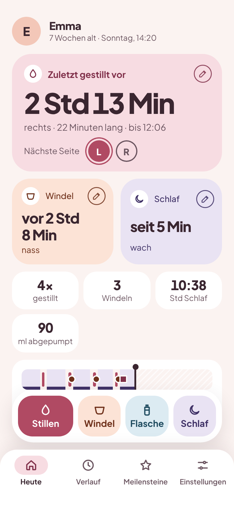
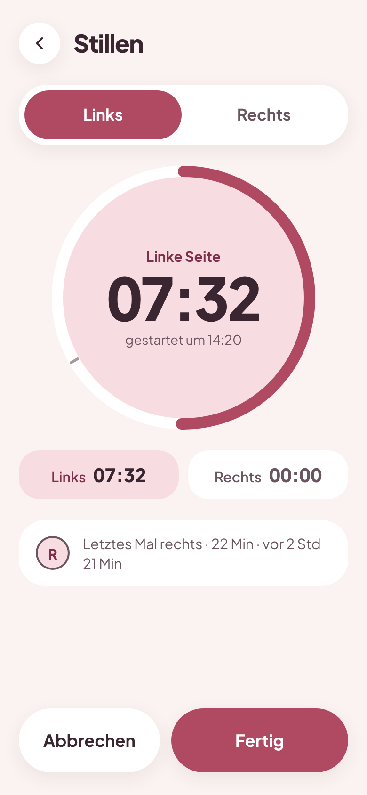
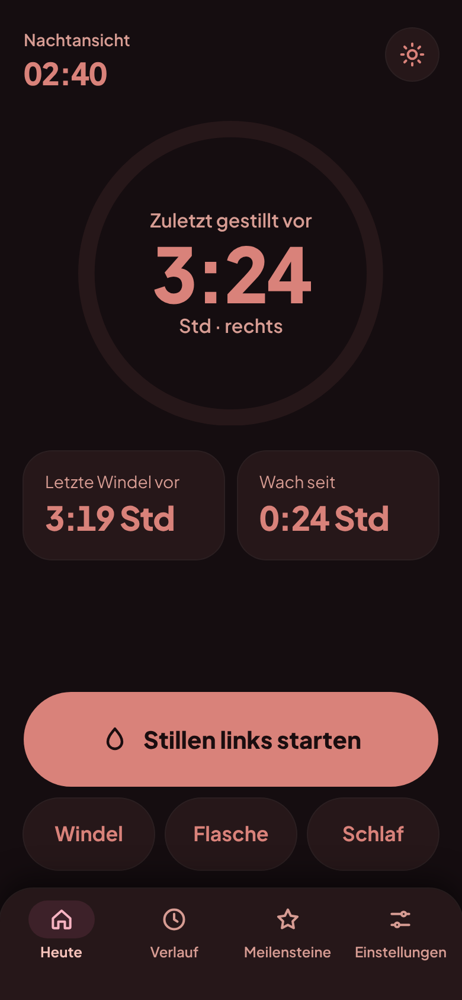
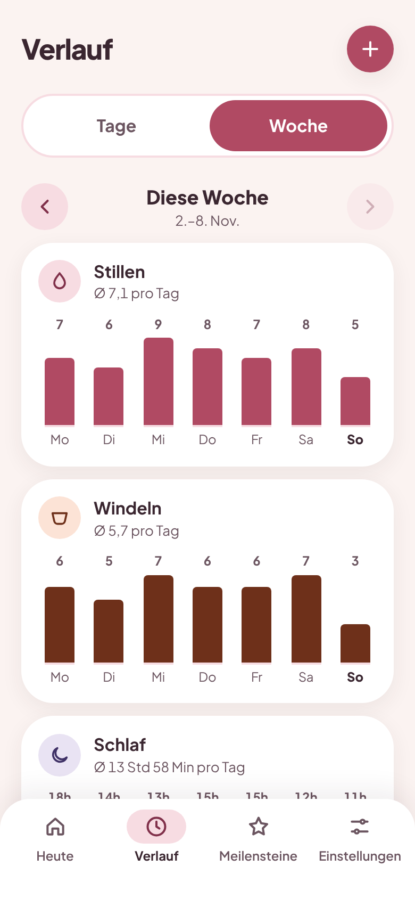
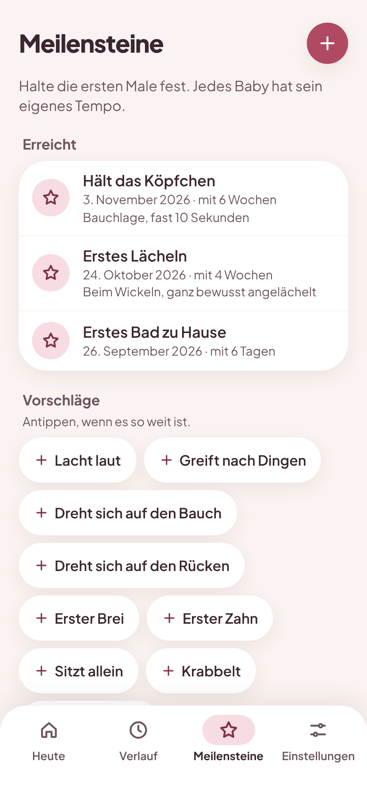
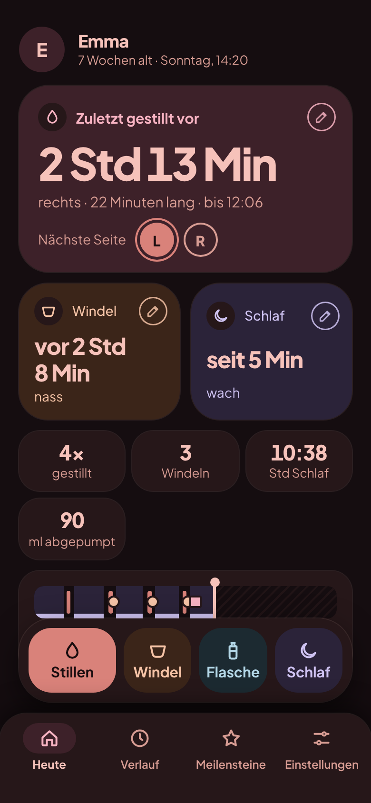

<div align="center">


# Baby Time

**Stillen, Windeln und Schlaf mit einer Hand festhalten. Offline, privat, ohne Konto.**

[**App öffnen**](https://babytime.mraz.app) · [English](README.md)

</div>

Baby Time ist ein ruhiges kleines Tagebuch für frischgebackene Eltern. Gemacht für 3 Uhr früh: große Knöpfe, eine Hand, eine dunkle Nachtansicht und nichts zum Anmelden. Alle Einträge bleiben auf deinem Handy.

<table>
  <tr>
    <td align="center" width="33%"><br><sub><b>Heute</b> – alles auf einen Blick</sub></td>
    <td align="center" width="33%"><br><sub><b>Stillen</b> – Timer, der sich die Seite merkt</sub></td>
    <td align="center" width="33%"><br><sub><b>Nachtansicht</b> – dunkel und schonend für müde Augen</sub></td>
  </tr>
  <tr>
    <td align="center"><br><sub><b>Verlauf</b> – Tage und Wochendiagramme</sub></td>
    <td align="center"><br><sub><b>Meilensteine</b> – erstes Lächeln, erstes Bad, eigene</sub></td>
    <td align="center"><br><sub><b>Dunkles Design</b> – auf Wunsch oder automatisch nachts</sub></td>
  </tr>
</table>

## Was die App kann

| | |
| --- | --- |
| 🤱 **Stillen** | Timer mit Seitenwechsel. Die App schlägt die nächste Seite vor und zeigt, wie lange das letzte Stillen her ist. |
| 🍼 **Flasche und Abpumpen** | Menge in ml, Muttermilch oder Pulvermilch, abgepumpte Seite. |
| 🧷 **Windeln** | Nass, voll oder beides in zwei Taps. |
| 🌙 **Schlaf** | Starten und beenden mit einem Tap, Tagessumme in Stunden und Minuten. |
| 📅 **Verlauf** | Liste nach Tagen und Wochenansicht mit Diagrammen. Einträge ändern, löschen und nachtragen. Direkt nach dem Speichern genügt ein Tap auf „Rückgängig“. |
| ⭐ **Meilensteine** | Vorschläge wie „Erstes Lächeln“ oder eigene, mit dem Alter des Babys an dem Tag. |
| 🎨 **Wie du willst** | Hell, dunkel oder nachts dunkel (20–7 Uhr), fünf Akzentfarben, nicht Gebrauchtes ausblenden. Deutsch und Englisch. |
| 💾 **Sicherung** | Export als Datei, auf Wunsch mit Passwort, mit sanfter Erinnerung alle zwei Wochen. |

## Wie eine App installieren

Baby Time ist eine Web-App (PWA). Auf dem Home-Bildschirm öffnet sie sich im Vollbild und läuft ohne Internet.

- **iPhone (Safari):** [babytime.mraz.app](https://babytime.mraz.app) öffnen → **•••** → **Teilen** → **Zum Home-Bildschirm**.
- **Android (Chrome):** Link öffnen → oben auf der Karte **Installieren** tippen, oder Menü **⋮** → **App installieren**.

Danach immer vom Home-Bildschirm starten. Safari kann Daten von Webseiten löschen, die nicht auf dem Home-Bildschirm liegen.

## Datenschutz

- **Kein Konto, kein Upload, keine Analyse, keine Werbung.** Die Einträge liegen nur im Browser auf deinem Gerät.
- Der Server (Cloudflare) liefert nur die App und ihre Updates aus. Er sieht wie jede Webseite die IP-Adresse, nie die Einträge.
- Eine strenge Content-Security-Policy verbietet der App jede Verbindung zu fremden Servern.
- Weil nichts das Handy verlässt, gibt es **keinen Abgleich zwischen Geräten**. Für ein neues Handy: Sicherung exportieren und dort wiederherstellen.

Baby Time ist kein Medizinprodukt und ersetzt keinen Rat von Hebamme, Ärztin oder Arzt.

## Selbst bauen

Voraussetzung: Node.js 24 oder neuer.

```
npm ci
npm run dev
```

Tests, Build und Auslieferung: [docs/ENTWICKLUNG.md](docs/ENTWICKLUNG.md). Entscheidungen stehen in [DECISIONS.md](DECISIONS.md), der ursprüngliche Auftrag in [spec.md](spec.md). Gebaut mit [Preact](https://preactjs.com/), [Dexie](https://dexie.org/) auf IndexedDB und [Vite](https://vite.dev/), getestet mit Vitest und Playwright, ausgeliefert als statische Dateien über Cloudflare Workers.

## Mitmachen

Fehler und Ideen gern als [Issue](../../issues/new/choose), auf Deutsch oder Englisch. Bitte keine Gesundheitsdaten und keine echten Babynamen. Mehr in [CONTRIBUTING.md](CONTRIBUTING.md). Sicherheitslücken bitte privat melden, siehe [SECURITY.md](SECURITY.md).

## Lizenz

[MIT](LICENSE). Die Schrift Plus Jakarta Sans steht unter der SIL Open Font License 1.1.
