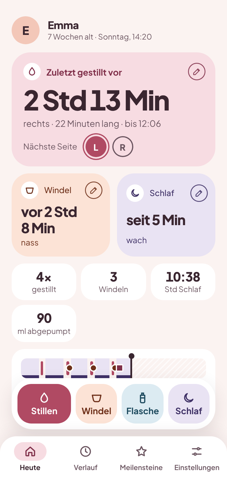
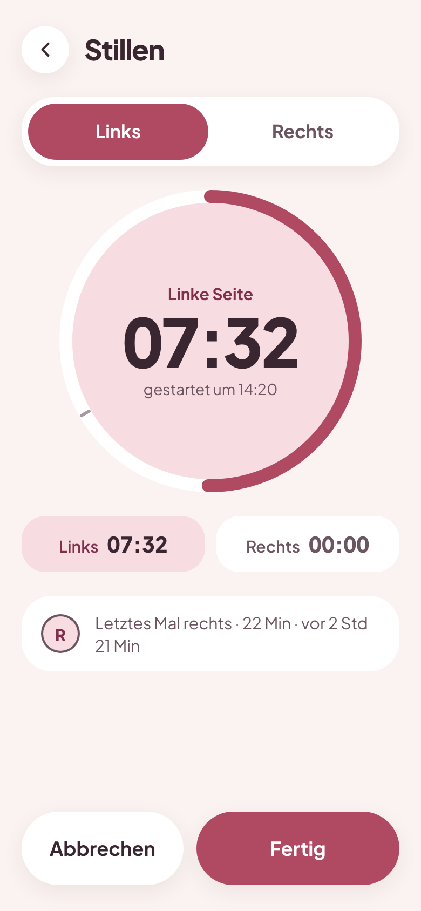
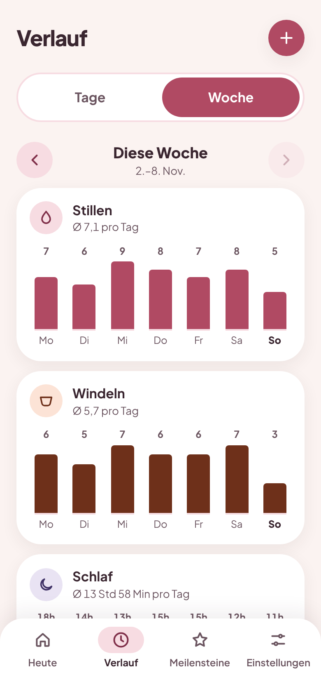
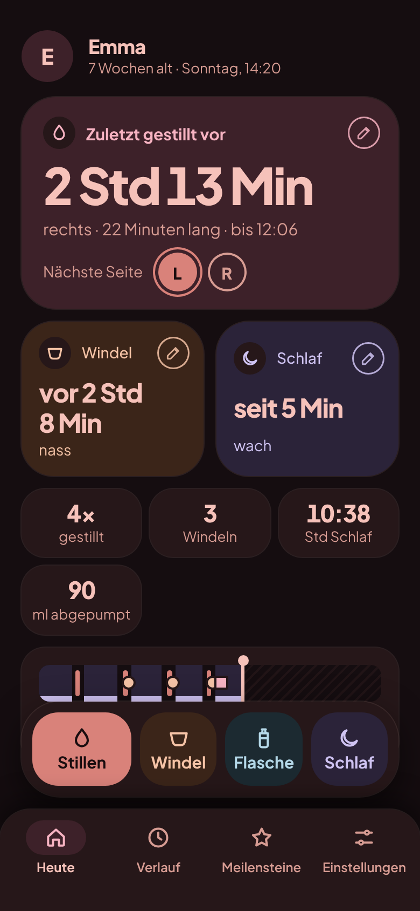
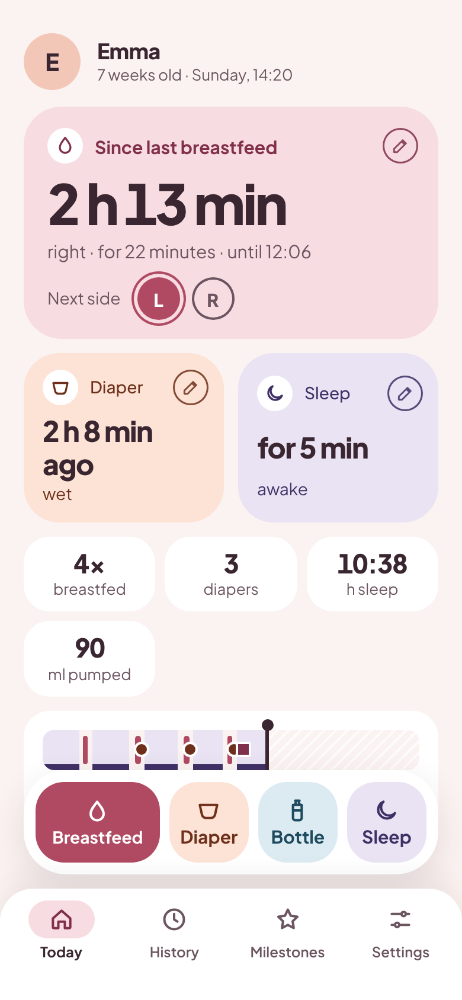
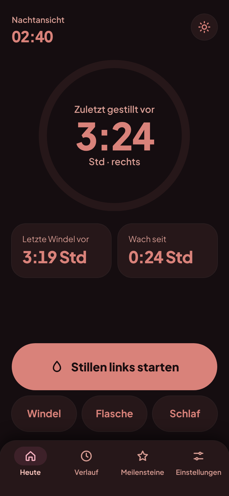
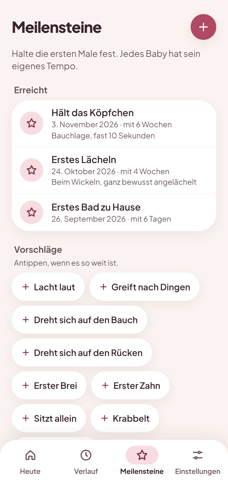

# Baby Time

Stillen, Windeln, Flasche und Schlaf mitschreiben – einhändig, offline, ohne Konto.
*Track breastfeeding, diapers, bottles and sleep – one-handed, offline, no account.* ([English below](#english))

**App öffnen:** https://babytime.mraz.app · Beta, Deutsch und Englisch

<p>
  
  
  
  
</p>

## Was die App kann

- **Heute:** zuletzt gestillt, nächste Seite, letzte Windel, Schlaf und Tageszähler auf einen Blick. Stillen mit Timer und Seitenwechsel, Windel in zwei Taps, Schlaf in einem, Flasche und Abpumpen mit Menge, jeweils mit „Rückgängig“.
- **Verlauf:** Liste nach Tagen und Wochenansicht; Einträge ändern, löschen und nachtragen.
- **Meilensteine:** erstes Lächeln, erstes Bad und Eigenes festhalten.
- **Nachtansicht** und dunkles Design, fünf Akzentfarben, jede Funktion einzeln abschaltbar.
- **Sicherung** als Datei, wahlweise mit Passwort verschlüsselt, mit Erinnerung.
- **Installierbar** als App auf iPhone und Android (PWA), läuft danach komplett offline.

## Datenschutz

Alle Einträge bleiben auf dem Gerät (IndexedDB im Browser). Es gibt kein Konto, keinen Upload, keine Analyse und keine Werbung. Der Server (Cloudflare) liefert nur die App und ihre Updates aus und sieht dabei wie jede Webseite die IP-Adresse, nie die Einträge. Die Content-Security-Policy verbietet der App jede Verbindung zu fremden Servern.

Baby Time ersetzt keinen Rat von Hebamme, Ärztin oder Arzt.

## Selbst bauen

Voraussetzung: Node.js 24 oder neuer.

```
npm ci
npm run dev
```

Tests, Build, Deployment und alle Details: [docs/ENTWICKLUNG.md](docs/ENTWICKLUNG.md). Entscheidungen stehen in [DECISIONS.md](DECISIONS.md), der ursprüngliche Auftrag in [spec.md](spec.md).

Technik: [Preact](https://preactjs.com/), [Dexie](https://dexie.org/) (IndexedDB), [Vite](https://vite.dev/) mit `vite-plugin-pwa`, Tests mit Vitest und Playwright, ausgeliefert als statische Dateien über Cloudflare Workers.

## Mitmachen

Fehler und Ideen gern als [Issue](../../issues/new/choose). Bitte keine Gesundheitsdaten und keine echten Babynamen in Texte oder Screenshots. Wie Beiträge ablaufen: [CONTRIBUTING.md](CONTRIBUTING.md). Sicherheitslücken bitte nicht öffentlich melden, sondern wie in [SECURITY.md](SECURITY.md) beschrieben.

## Lizenz

[MIT](LICENSE). Die Schrift Plus Jakarta Sans steht unter der SIL Open Font License 1.1.

---

## English

Baby Time is a small web app for new parents to log breastfeeding (with timer and side switching), diapers, bottles, pumping, sleep and milestones. It is built for one hand at 3 a.m.: big buttons, a night view and a dark theme.

- **Try it:** https://babytime.mraz.app (beta). Install it to your home screen and it works fully offline.
- **Privacy:** everything stays on your device. No account, no upload, no analytics. The host (Cloudflare) only serves the app and sees your IP address like any website, never your entries.
- **Languages:** German and English, switchable in Settings.
- **Not medical advice.**

<p>
  
  
  
</p>

Build it yourself with `npm ci` and `npm run dev` (Node.js 24+). The developer docs are in German: [docs/ENTWICKLUNG.md](docs/ENTWICKLUNG.md). Issues and pull requests in English are welcome, see [CONTRIBUTING.md](CONTRIBUTING.md). Licensed under [MIT](LICENSE).
