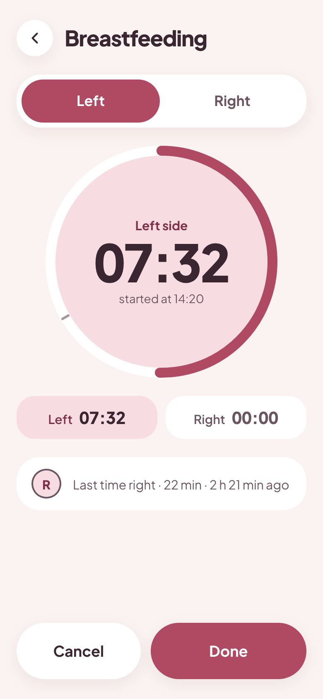
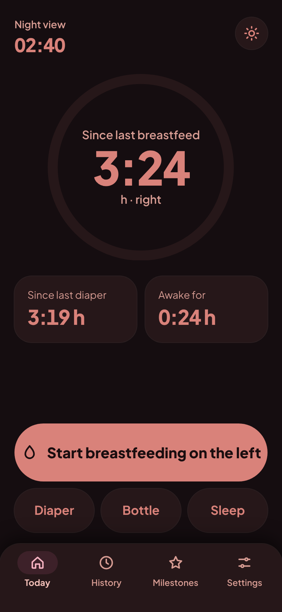
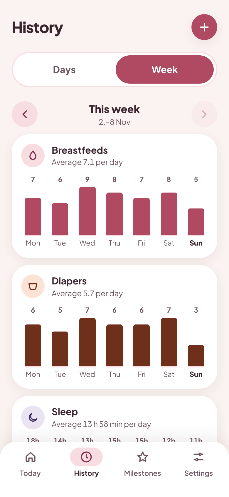
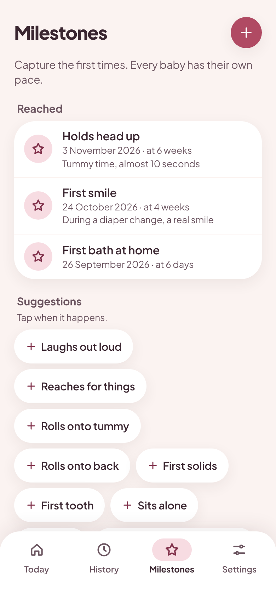
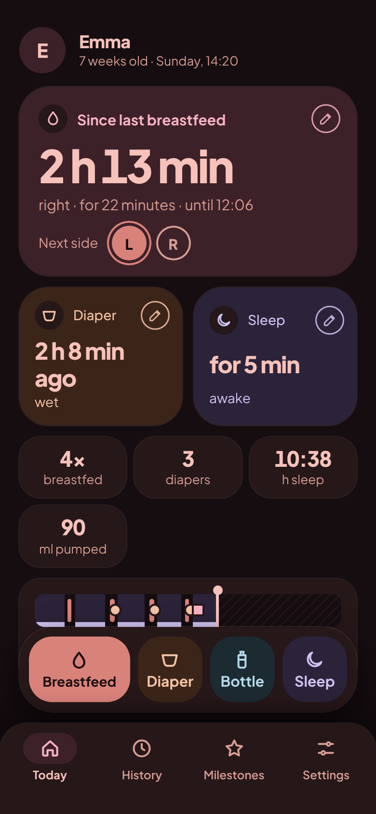

<div align="center">


# Baby Time

**Log breastfeeding, diapers and sleep with one hand. Offline, private, no account.**

[**Open the app**](https://babytime.mraz.app) · [Deutsch](README.de.md)

</div>

Baby Time is a calm little diary for new parents. It is made for 3 a.m.: big buttons, one hand, a dark night view, and nothing to sign up for. Every entry stays on your phone.

<table>
  <tr>
    <td align="center" width="33%"><br><sub><b>Today</b> – everything at a glance</sub></td>
    <td align="center" width="33%"><br><sub><b>Breastfeeding</b> – timer that remembers the side</sub></td>
    <td align="center" width="33%"><br><sub><b>Night view</b> – dark and easy on tired eyes</sub></td>
  </tr>
  <tr>
    <td align="center"><br><sub><b>History</b> – days and weekly charts</sub></td>
    <td align="center"><br><sub><b>Milestones</b> – first smile, first bath, your own</sub></td>
    <td align="center"><br><sub><b>Dark theme</b> – on demand or automatically at night</sub></td>
  </tr>
</table>

## What it does

| | |
| --- | --- |
| 🤱 **Breastfeeding** | Timer with side switching. The app suggests the next side and shows how long ago the last feed ended. |
| 🍼 **Bottle and pumping** | Amount in ml, breast milk or formula, pumped side. |
| 🧷 **Diapers** | Wet, dirty or both in two taps. |
| 🌙 **Sleep** | Start and stop with one tap, daily total in hours and minutes. |
| 📅 **History** | List by day and a week view with charts. Edit, delete or add entries afterwards. Right after saving, "Undo" is one tap away. |
| ⭐ **Milestones** | Suggestions like "first smile" or add your own, with the baby's age on that day. |
| 🎨 **Your way** | Light, dark or dark at night (8 p.m.–7 a.m.), five accent colours, switch off what you don't track. German and English. |
| 💾 **Backup** | Export to a file, optionally password-protected, with a gentle reminder every two weeks. |

## Install it like an app

Baby Time is a web app (PWA). Once added to your home screen, it opens full screen and works without internet.

- **iPhone (Safari):** open [babytime.mraz.app](https://babytime.mraz.app) → tap **•••** → **Share** → **Add to Home Screen**.
- **Android (Chrome):** open the link → tap **Install** on the card at the top, or menu **⋮** → **Install app**.

Always start it from the home screen afterwards. Safari may delete data of websites that were not added to the home screen.

## Privacy

- **No account, no upload, no analytics, no ads.** Entries are stored only in your browser on your device.
- The host (Cloudflare) only delivers the app and its updates. Like any website it sees your IP address, never your entries.
- A strict Content Security Policy blocks the app from talking to any other server.
- Because data never leaves the phone, there is **no sync between devices**. To move to a new phone, export a backup and restore it there.

Baby Time is not a medical device and does not replace advice from your midwife or doctor.

## Build it yourself

You need Node.js 24 or newer.

```
npm ci
npm run dev
```

Tests, build and deployment are described in [docs/ENTWICKLUNG.md](docs/ENTWICKLUNG.md) (German). Built with [Preact](https://preactjs.com/), [Dexie](https://dexie.org/) on IndexedDB and [Vite](https://vite.dev/), tested with Vitest and Playwright, served as static files from Cloudflare Workers.

## Contributing

Bug reports and ideas are welcome as [issues](../../issues/new/choose), in English or German. Please don't include health data or real baby names. See [CONTRIBUTING.md](CONTRIBUTING.md). Report security issues privately as described in [SECURITY.md](SECURITY.md).

## License

[MIT](LICENSE). The Plus Jakarta Sans font is licensed under the SIL Open Font License 1.1.
